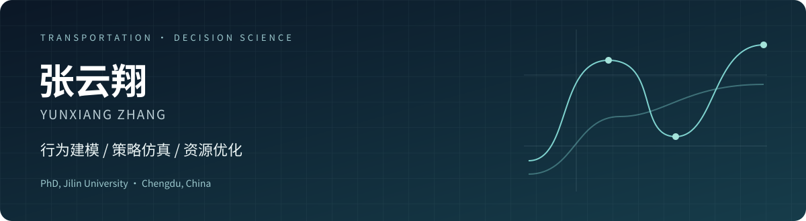
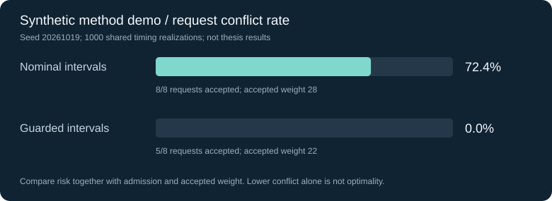

<p align="center"></p>

<p align="center"><a href="research/README.md">研究总览</a> · <a href="examples/README.md">运行方法演示</a> · <a href="research/publications.md">代表成果</a> · <a href="index.html">交通信息工程网页源码</a></p>

## 可运行的软件 · ParkingOps Lab

[打开软件源码与使用说明](software/parking-ops-lab/README.md) · [界面预览](software/parking-ops-lab/docs/dashboard.png) · [完整实验输出](software/parking-ops-lab/examples/default-run/result.json)

预约泊位优化实验台，支持 CSV 导入、SciPy/HiGHS 整数规划、三策略对比、随机到离场仿真、SVG 泊位排程和报告导出。可选连接 Ollama，让本地模型解释服务端算出的汇总指标。

这是新建的软件作品，示例使用合成数据，不是论文原始代码或线上运营系统。本机 27 项测试通过；真实模型推理尚未验证，标准求解与报告不依赖模型。

<a href="software/parking-ops-lab/README.md"></a>

## 从用户选择，到服务策略与资源分配

我是张云翔，吉林大学交通信息工程及控制博士，现居成都。研究交通出行中的行为差异、长期策略效果与有限资源分配，使用 R、Python、AnyLogic 和 VISSIM 将模型转成可计算、可比较的实验。

智慧停车是我博士研究的主要场景。同样的价格与距离，为什么用户仍作出不同选择？改善哪类服务能带来更持久的用户响应？车辆早到或晚离时，怎样分配预约资源并控制冲突？这些问题构成下面三个相互连接的研究方向。

| 研究问题 | 方法 | 研究中的验证结果 | 材料 |
| --- | --- | --- | --- |
| 区分主动偏好与被动依赖，预测停车方案选择 | 多群组结构方程、集成潜变量的混合选择模型 | 真实忠诚群体测试集准确率 **79.82% → 84.17%** | [行为建模](research/behavior-modeling.md) |
| 比较干预的起效速度和长期持续性 | 马尔可夫状态演化、Logit 响应、智能体仿真 | 长期仿真中真实忠诚群体占比 **30.05% → 32.67%** | [策略评估](research/strategy-simulation.md) |
| 处理早到、晚离与泊位时段重叠 | 冲突概率、多目标混合整数规划、动态缓冲 | 指定模型实验中服务冲突率 **7.6% → 0.43%** | [资源优化](research/parking-allocation.md) |

上述结果来自博士研究的测试与仿真实验。各项指标的群体范围、实验条件和解释见对应文档。

## 一个可以直接运行的方法演示

[预约泊位分配演示](examples/README.md)以小规模合成请求比较名义时段分配与带缓冲的分配。程序包含精确枚举、随机到离场时间、共同随机数对照和边界测试，只使用 Python 标准库。

```bash
python examples/parking_allocation_demo.py
python -m unittest discover -s examples/tests -v
```



演示为本次整理作品集时新增的简化实现，使用合成数据，与上表原研究结果分开呈现。数据生成方式、冲突率分母、随机种子和方法限制见[演示说明](examples/README.md)。

## 方法与实现

| 能力 | 具体工作 |
| --- | --- |
| 行为计量 | 使用 R 编写似然函数与参数估计程序，比较群体间的行为驱动差异 |
| 策略仿真 | 由实证参数初始化智能体，将服务体验、认知更新与状态迁移连接起来 |
| 资源分配 | 将不准时造成的冲突纳入分配约束，比较收益、用户成本与履约风险 |
| 仿真工具 | AnyLogic 智能体控制逻辑，VISSIM COM 接口自动控制脚本 |

## 代表成果

- 第一作者，*Investigating Factors for Travelers’ Parking Behavior Intentions in Changchun, China, under the Influence of Smart Parking Systems*，Sustainability，2023。[论文全文](https://www.mdpi.com/2071-1050/15/15/11685)
- 第一作者，《基于用户满意度的停车预约服务智能体行为仿真》，吉林大学学报（工学版），已发表。
- 已授权发明专利 5 项，其中第一发明人 1 项。[成果列表](research/publications.md)

## 仓库导航

```text
software/       可运行的预约泊位优化实验台
research/       研究问题、方法、指标口径与代表成果
examples/       本次新增的小规模方法演示及测试
assets/         研究总览和演示结果图
research.html   可在浏览器打开的研究作品集
index.html      原交通信息工程专业介绍网页
```

联系邮箱 `zachyun@163.com`。欢迎围绕出行行为、策略仿真与交通资源优化交流。
