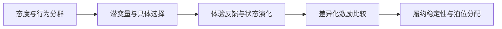

# 研究总览

我的博士研究沿着同一条问题链展开：先解释用户为什么作出不同选择，再比较服务干预的长期效果，最后将用户差异带入资源分配。

| 专题 | 读完后能了解什么 | 材料类型 |
| --- | --- | --- |
| [用户行为与选择预测](behavior-modeling.md) | 为什么不能仅按使用频率判断忠诚，认知变量怎样进入选择模型 | 研究说明 |
| [长期激励策略评估](strategy-simulation.md) | 一次性的效果与长期群体结构变化怎样区分 | 研究说明 |
| [预约泊位分配](parking-allocation.md) | 晚离和早到怎样产生冲突，怎样将风险带入资源约束 | 研究说明与简化方法演示 |

## 阅读指标的三个条件

1. 84.17% 仅对应真实忠诚群体的测试集预测准确率。
2. 32.67% 是长期策略仿真中的群体占比结果，以峰值和高位累计持续时间评价策略。
3. 98.2% 的接纳率与 0.43% 的服务冲突率来自供需比接近 1.0、存在不准时行为的模型实验。

这里的说明整理自本人博士论文与研究经历。仓库中的 Python 示例是新编写的说明性程序，原研究实验与示例实验各自独立。
