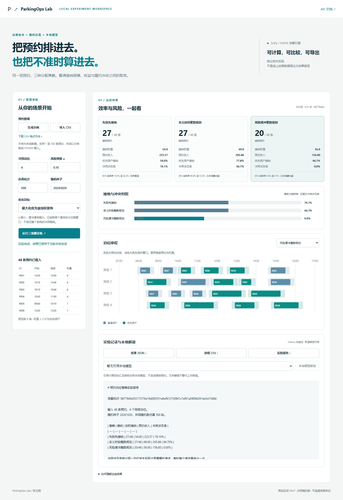

# ParkingOps Lab

### 预约泊位优化实验台

**把用户优先级、到离场偏差和有限泊位放进同一个可运行的实验。**

Python · SciPy/HiGHS · FastAPI · 原生 JavaScript/SVG · 可选 Ollama



停车预约的难处不只是把时间表排满。前车晚离、后车早到会把原本不重叠的预约变成履约冲突；增加保护时间，又可能拒绝更多预约。本项目用同一组请求和同一组随机到离场样本比较三种策略，让这个取舍可以检查。

这是 2026 年新建的软件作品，受停车行为与资源分配研究启发。它不是博士论文原始程序，不复现论文中的 98.2% 等研究结果，也没有声称在实际停车场上线。示例数据完全合成，用户可导入自己的 CSV。

## 可以做什么

| 功能 | 实际实现 |
| --- | --- |
| 数据导入 | 严格 CSV 字段校验、时间解析、重复 ID 与数值边界校验 |
| 分配求解 | FCFS 基准、名义区间 MILP、分位数缓冲 MILP |
| 结果评估 | 共同随机数蒙特卡洛，接纳、权重、预约收入、优先用户接纳与冲突指标 |
| 过程检查 | 每个泊位的预约时段和保护窗口、求解状态、最优性间隙 |
| 可复现输出 | 随机种子、输入配置哈希、依赖版本、排程 CSV、结果 JSON 与实验报告 |
| 本地模型 | 可选 Ollama 对汇总指标进行解释；不参与求解，不执行模型生成代码 |

## 本地启动

需要 Python 3.12。Windows 可双击 `start.bat`，首次运行会在项目内创建虚拟环境并安装依赖。也可以在本目录执行

```bash
python -m venv .venv
# Windows
.venv\Scripts\python -m pip install -r requirements.txt
.venv\Scripts\python -m uvicorn parkinglab.api:app --host 127.0.0.1 --port 8000
# macOS / Linux 对应使用 .venv/bin/python
```

浏览器打开 <http://127.0.0.1:8000>，接口说明位于 `/docs`。点击生成示例、调整泊位与目标、运行实验，即可查看三种策略。网页需要 Python 后端，不能用 GitHub Pages 直接运行。

命令行批量实验

```bash
python -m parkinglab --slots 4 --trials 500 --seed 20261020 --output results
python -m parkinglab --csv examples/default-run/input.csv --output results/imported
python scripts/sweep.py
```

最后一条会对 48、100、300 条合成请求及三档风险预算运行敏感性实验，写入 `docs/sensitivity.json`。记录中的耗时是单机单次运行，不能当作可靠的跨机器性能结论。

容器方式

```bash
docker build -t parkingops-lab .
docker run --rm -p 127.0.0.1:8000:8000 parkingops-lab
```

Dockerfile 已提供，但当前开发机没有进行镜像构建验证。默认容器不能访问宿主机 Ollama；容器演示先使用不依赖模型的标准报告。

## 数据格式

```csv
id,start,end,fee,priority,arrival_mean,arrival_std,departure_mean,departure_std
R001,08:00,09:00,10,4,-2,4,4,5
R002,09:00,10:00,8,1,-2,4,4,5
```

必需列为 `id,start,end`，其余可以省略。时间为当天分钟数或 `HH:MM`，至少停留 5 分钟，不跨天。偏差参数单位均为分钟，负值表示早到或早离。`fee` 是接纳后对应的预约金额，未扣除冲突、退款、运营成本，**不是净利润**。`priority` 为 1 至 10 的输入权重，默认 1，≥3 的请求计入优先用户指标。示例中优先用户权重为 4，其余为 1。

上限为 300 条请求、20 个泊位、3000 轮仿真。界面配置的优化目标同时用于两个 MILP；FCFS 始终按预约开始时间排序，排序相同时按输入顺序处理，不使用真实下单时间。

## 模型与求解

每个请求有固定预约区间 `[s_i,e_i)`，接受变量 `x_i∈{0,1}`。两个优化目标可选

```text
max Σ priority_i × x_i
或
max Σ fee_i × x_i

对每个区间起始事件 t
Σ x_i × 1[start_i ≤ t < end_i] ≤ 泊位数
```

固定区间的占用峰值发生在区间起点，因此检查这些事件即可。SciPy 的 `milp` 调用 HiGHS 求解二元模型，再用堆实现区间着色，把接纳请求分配给具体同质泊位。相邻预约可以共用端点。本模型没有可变开始时刻、异质车位或在线重规划；固定区间问题也可以用网络流等方法求解，使用 MILP 是为了提供清晰可扩展的建模入口，不是新算法声明。

缓冲策略根据每条请求的到离场正态偏差构造保护区间

```text
α_i = α / sqrt(priority_i)
z_i = NormalQuantile(1 - α_i/2)
early_i = max(0, z_i × arrival_std_i - arrival_mean_i)
late_i  = max(0, departure_mean_i + z_i × departure_std_i)
保护区间 = [s_i - early_i, e_i + late_i)
```

这个分位数规则为高权重请求保留较大保护窗口。它是规划启发式，**没有给出整个系统的联合冲突概率保证**。优先用户最终接纳率也不一定在所有场景中最高。较小 α 通常增大窗口、收紧可行集；不能据此声称每个样本的经验冲突率严格单调。

求解器返回最优解时标记 `optimal=true`，限时但有可行解时展示未证最优状态和可用间隙。任何可行接纳集都再次通过区间着色检查容量。

## 仿真指标与边界

三种策略共享相同到离场随机样本，减少比较时的随机噪声。不同请求与到离场偏差相互独立，未拟合真实行为分布。若离场早于到达，则将实际离场修正为到达后 0.001 分钟，并记录修正次数。

同一泊位上两个实际占用区间相交，就认为这两个请求涉及冲突。每轮每个请求最多计一次。先计算每轮“涉及冲突请求数 / 已接纳请求数”，再对轮次取均值。零接纳时冲突率为 `null`，不能当成零风险成绩。它不是事故率、违约金额或冲突对数。

95% 抽样界使用轮次层面的 Hoeffding 不等式

```text
ε = sqrt(log(40) / (2 × trials))
区间 = [max(0, rate - ε), min(1, rate + ε)]
```

同一轮内的请求可能相关，故没有把所有请求当作独立伯努利样本。这个界很保守，只描述蒙特卡洛抽样误差，不涵盖模型误差。即使 500 轮观测到零冲突，上界也不是零。

默认合成场景下，名义模型容易把预约紧密衔接，轻微到离场偏差也会被计入冲突。因此其冲突涉及率可能较高；缓冲策略降低这一指标的同时也可能明显降低接纳与金额。请同时看所有指标，不选择性汇报。

## 可选本地大模型

本项目不重新上传模型权重，也不将 Ollama 或基础模型标为原创。先按 [Ollama 官方文档](https://docs.ollama.com/) 安装服务，并根据电脑内存与硬件自行选择已经可运行的模型。启动本地 Ollama 后刷新实验台，页面通过 `/api/tags` 列出已有模型，再通过 `/api/chat` 请求解释。

默认连接 `http://127.0.0.1:11434`。开发时可设置 `PARKINGLAB_OLLAMA_URL`，但适配器只接受回环 HTTP 地址。只发送服务端保存的配置与汇总指标，不发送原始 CSV、逐条排程、个人资料或任意命令；不使用外部模型 API。系统提示要求避免补造结果，但生成文字仍可能有误，计算指标才是判断依据。

当前开发环境没有安装模型权重，**真实模型推理尚未验证**。已通过本机模拟 HTTP 服务验证请求路径、非流式响应格式、数据筛选和不可用时的降级行为。没有模型时，全部求解、仿真、图表及标准报告都可以使用。

## 验证与代码结构

```bash
python -m pip install -r requirements-dev.txt
python -m pytest -q
```

本机 27 项测试通过，覆盖极小实例的穷举最优值对照、半开区间、容量可行性、冲突检测与独立两两检测对照、CSV 校验、固定种子复现、API 流程和 Ollama 接口契约。浏览器检查覆盖 CSV 导入、错误反馈、运行、切换排程、JSON 下载与桌面/手机布局。开发依赖中的 Starlette TestClient 当前会提示 httpx 适配将被弃用，不影响本次通过结果。

```text
parkinglab/
  domain.py       输入边界、CSV、合成数据
  optimizer.py    保护窗口、MILP、泊位着色
  simulation.py   共同随机数、冲突评估、固定报告
  ollama.py       本地模型 HTTP 适配器
  api.py          本地服务与有限实验记录缓存
  static/         浏览器交互、指标卡、SVG 排程
tests/            数学与接口验证
scripts/sweep.py  敏感性实验
examples/         一次默认运行的输入与完整结果
docs/             实际界面截图与实验记录
```

实验记录保存在内存中，最多 20 次，服务重启后消失。服务默认仅监听本机；没有多用户认证、持久数据库、任务队列或生产监控，不能直接当作公开生产服务部署。不同求解器版本在多最优解情形下可能选择不同预约，固定种子并不保证跨版本排程逐位相同。

## 技术依据

- [SciPy milp 官方接口](https://docs.scipy.org/doc/scipy/reference/generated/scipy.optimize.milp.html)
- [Ollama Chat API](https://docs.ollama.com/api/chat)
- [FastAPI StaticFiles](https://fastapi.tiangolo.com/tutorial/static-files/)

本目录代码采用 MIT 许可，基础求解器、框架与模型各遵循其自身许可。
